# VisorGuBIMGal — Software Design Document (SDD)

> **Versión:** 1.0.0  
> **Fecha:** 2026-10-17  
> **Autor:** GuBIM Galicia  
> **Licencia objetivo:** MPL-2.0  
> **Metodología:** SDD (Software Design Document) — IEEE 1016 adaptado a Agile  

---

## Índice

1. [Introducción y Alcance](#1-introducción-y-alcance)
2. [Contexto del Sistema](#2-contexto-del-sistema)
3. [Decisiones Tecnológicas y Justificaciones](#3-decisiones-tecnológicas-y-justificaciones)
4. [Arquitectura de Alto Nivel](#4-arquitectura-de-alto-nivel)
5. [Diseño Detallado de Componentes](#5-diseño-detallado-de-componentes)
6. [Modelo de Datos](#6-modelo-de-datos)
7. [Flujos de Interacción](#7-flujos-de-interacción)
8. [Requisitos No Funcionales](#8-requisitos-no-funcionales)
9. [Estructura del Proyecto](#9-estructura-del-proyecto)
10. [Pipeline de Despliegue](#10-pipeline-de-despliegue)
11. [Alternativas Descartadas](#11-alternativas-descartadas)
12. [Glosario](#12-glosario)
13. [Roadmap de Fases](#13-roadmap-de-fases)

---

## 1. Introducción y Alcance

### 1.1 Propósito

Este documento define la arquitectura, componentes, decisiones de diseño y plan de implementación del **VisorGuBIMGal**: un visor BIM de código abierto, 100% frontend, desplegable en GitHub Pages, con capacidades GIS integradas y exportación a DXF.

### 1.2 Alcance

| Dentro del alcance | Fuera del alcance |
|---|---|
| Carga simultánea de múltiples ficheros IFC (modelos federados) | Backend / servidor de procesamiento |
| Visualización 3D con WebGPU (fallback WebGL) | Edición/autoría de modelos IFC |
| Navegación por estructura espacial IFC | Conversión server-side de formatos |
| Planos de sección y plantas (2D) | Clash detection (fase futura) |
| Exportación de secciones/plantas a DXF | Validación IDS (fase futura) |
| Geolocalización de modelos en mapa GIS | Colaboración BCF en tiempo real |
| Superposición de capas GIS (WMS/WFS, GeoJSON) | Almacenamiento en la nube |
| Despliegue estático en GitHub Pages | Autenticación de usuarios |

### 1.3 Audiencia

- Desarrolladores del proyecto
- Contribuidores open-source
- Administraciones públicas (Xunta de Galicia, concellos)
- Profesionales AEC que necesiten un visor ligero

### 1.4 Definiciones y Acrónimos

Ver [§12 Glosario](#12-glosario).

---

## 2. Contexto del Sistema

### 2.1 Problema

Las administraciones públicas y profesionales AEC de Galicia necesitan un visor BIM:
- **Sin instalación**: accesible desde cualquier navegador moderno.
- **Sin backend**: que no dependa de servidores costosos ni licencias.
- **Federado**: que soporte múltiples disciplinas (ARQ + EST + MEP) simultáneamente.
- **Con contexto geográfico**: que permita situar los modelos en su ubicación real.
- **Con documentación técnica**: que genere plantas y secciones exportables a DXF para interoperabilidad con herramientas CAD.

### 2.2 Diagrama de Contexto (C4 — Nivel 1)

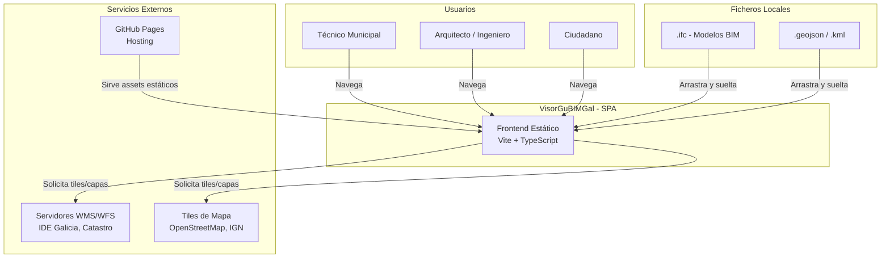

---

## 3. Decisiones Tecnológicas y Justificaciones

### 3.1 Motor BIM: IFCLite

| Criterio | IFCLite | web-ifc / That Open Engine | Decisión |
|---|---|---|---|
| **Core** | Rust - WASM (aritmética exacta) | C++ - WASM | IFCLite |
| **Rendering** | WebGPU nativo + fallback Three.js | Solo WebGL/Three.js | IFCLite |
| **Memoria** | Columnar TypedArrays (~260 KB gz) | Object trees (pesado) | IFCLite |
| **2D Drawings** | `@ifc-lite/drawing-2d` integrado | No incluido | IFCLite |
| **DXF Export** | Nativo (R12 georreferenciado) | Requiere lib externa | IFCLite |
| **Schemas** | IFC2X3, IFC4, IFC4X3, IFC5 IFCX | IFC2X3, IFC4 | IFCLite |
| **Licencia** | MPL-2.0 | AGPL-3.0 | IFCLite |

**Justificación**: IFCLite ofrece un pipeline completo (parse, render, query, draw-2d, export-DXF) en un bundle compacto, con rendimiento superior gracias a Rust/WASM y WebGPU nativo. Su licencia MPL-2.0 es más permisiva para proyectos institucionales.

#### Paquetes @ifc-lite utilizados

| Paquete | Función en el proyecto |
|---|---|
| `@ifc-lite/parser` | Parsing de ficheros IFC (STEP) a store columnar |
| `@ifc-lite/geometry` | Generación de geometría 3D (booleanas, instancing) |
| `@ifc-lite/renderer` | Renderizado WebGPU del viewport 3D |
| `@ifc-lite/query` | Consultas de propiedades y filtrado de elementos |
| `@ifc-lite/drawing-2d` | Generación de secciones, plantas, alzados (SVG/DXF) |
| `@ifc-lite/bcf` | Soporte BCF para viewpoints (fase futura) |
| `@ifc-lite/data` | Store columnar in-memory (TypedArrays) |

### 3.2 Motor GIS: MapLibre GL JS

| Criterio | MapLibre GL JS | CesiumJS | Decisión |
|---|---|---|---|
| **Peso del bundle** | ~300 KB gz | ~3 MB gz | MapLibre |
| **Rendering** | WebGL2 / WebGPU (v5+) | WebGL | MapLibre |
| **Custom Layers** | CustomLayerInterface (Three.js bridge) | Primitivas propias | MapLibre |
| **Estilos vectoriales** | Nativo (spec Mapbox) | Limitado | MapLibre |
| **3D Terrain** | Sí (setTerrain) | Sí (globo 3D) | Empate |
| **Licencia** | BSD-3-Clause | Apache-2.0 | Ambas OK |
| **Complejidad** | Media | Alta | MapLibre |

**Justificación**: Para un visor BIM que necesita contexto geográfico (no un globo planetario), MapLibre ofrece la mejor relación peso/funcionalidad. Su API de Custom Layers permite inyectar la escena 3D del BIM directamente en el canvas del mapa con sincronización de cámara.

### 3.3 Exportación DXF

| Opción | Decisión | Justificación |
|---|---|---|
| `@ifc-lite/drawing-2d` (export nativo) | **Principal** | Export DXF R12 integrado, con georreferenciación automática vía IfcMapConversion |
| `dxf-writer` | **Fallback** | Generación DXF programática para geometrías customizadas no cubiertas por IFCLite |
| `Maker.js` | Descartado | Sobredimensionado; su motor paramétrico no aporta valor aquí |

### 3.4 Transformación de Coordenadas: Proj4js

- **Librería**: `proj4` (npm)
- **Función**: Transformar coordenadas locales del modelo IFC (site origin) a CRS geográficos (EPSG:4326 / EPSG:3857) y CRS proyectados españoles (EPSG:25829 ETRS89 / UTM zona 29N para Galicia).
- **Integración**: Lee IfcMapConversion e IfcProjectedCRS del IFC para georreferenciar automáticamente.

### 3.5 Framework de Aplicación

| Decisión | Valor |
|---|---|
| **Bundler** | Vite 6.x |
| **Lenguaje** | TypeScript 5.x (strict mode) |
| **Framework UI** | Vanilla TS + Web Components (LitElement 4.x) |
| **Estilos** | Vanilla CSS con Custom Properties (design tokens) |
| **Estado** | Patrón Observable Store (sin framework pesado) |
| **Testing** | Vitest + Playwright |
| **Linting** | ESLint flat config + Prettier |

**Justificación de Vanilla + Lit**: Al ser un visor técnico (no una app CRUD), la mayor parte de la lógica reside en los motores BIM/GIS. Un framework pesado (React/Vue) añadiría bundle size y complejidad innecesaria. LitElement proporciona Web Components estándar, reactivos y ligeros (~5 KB), ideales para los paneles de UI.

---

## 4. Arquitectura de Alto Nivel

### 4.1 Diagrama de Contenedores (C4 — Nivel 2)

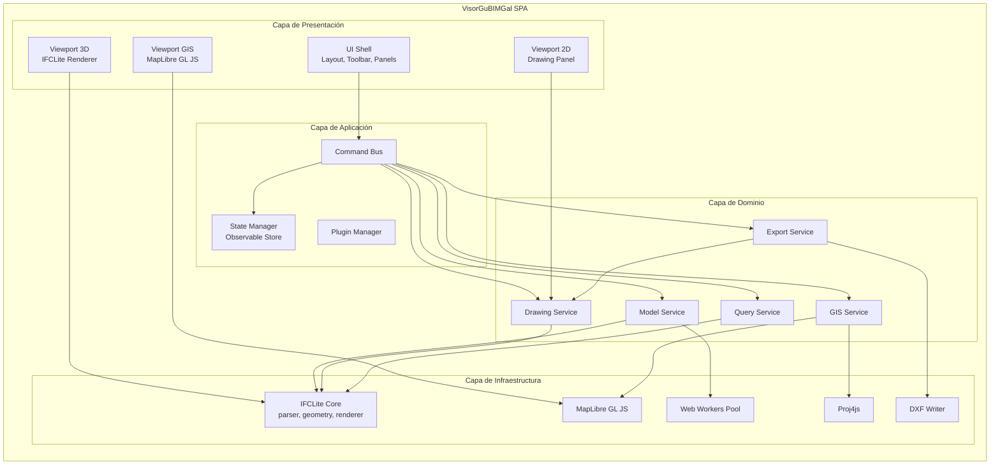

### 4.2 Principios Arquitectónicos

| Principio | Aplicación |
|---|---|
| **Separación de Concerns** | 4 capas bien delimitadas: Presentación, Aplicación, Dominio, Infraestructura |
| **Dependency Inversion** | Los servicios de dominio dependen de interfaces, no de implementaciones concretas de IFCLite/MapLibre |
| **Single Responsibility** | Cada servicio encapsula una única responsabilidad (modelos, GIS, dibujos, exportación, consultas) |
| **Open/Closed** | Sistema de plugins para extensibilidad sin modificar el core |
| **Event-Driven** | Command Bus desacopla UI de lógica de negocio; eventos tipados para comunicación inter-módulo |
| **Fail-Safe Degradation** | WebGPU a WebGL fallback; GIS opcional si no hay conexión |

### 4.3 Patrón de Comunicación

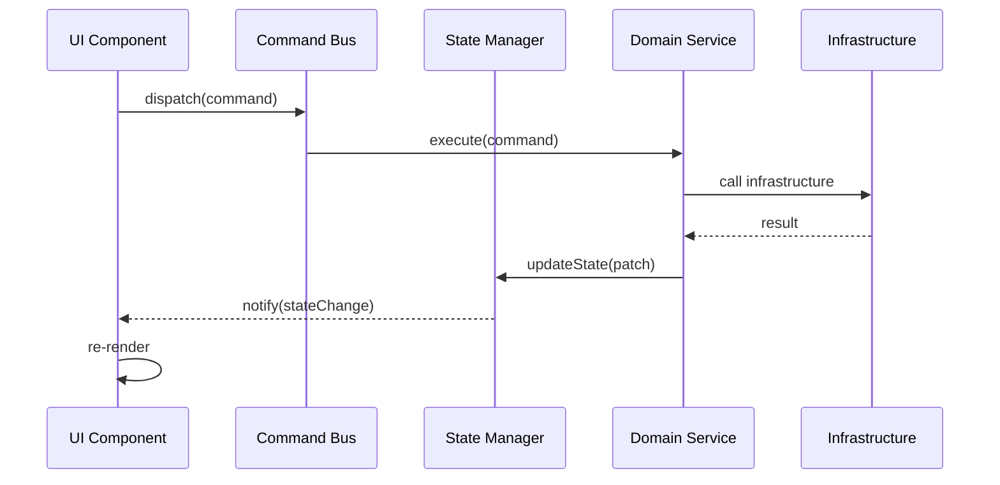

---

## 5. Diseño Detallado de Componentes

### 5.1 Model Service — Gestión de Modelos Federados

**Responsabilidad**: Cargar, registrar, coordinar y descargar múltiples modelos IFC.

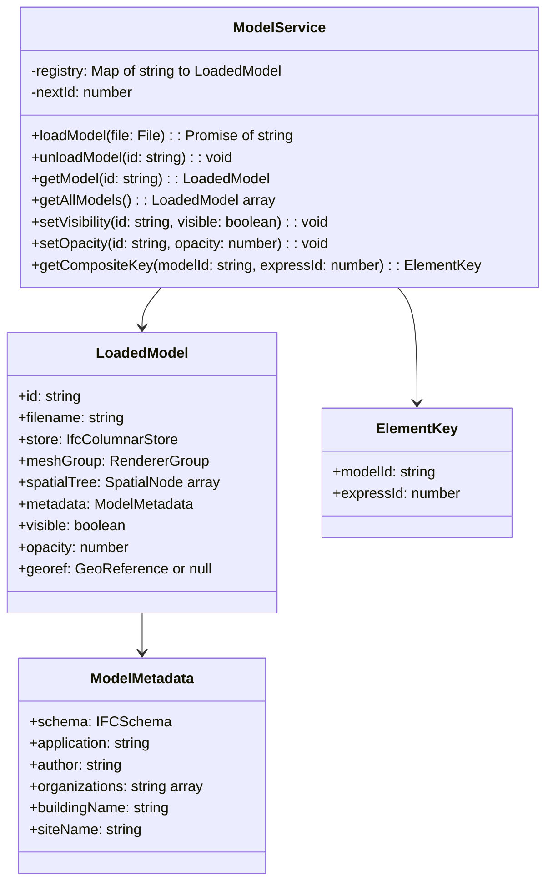

#### Estrategia de ID Compuestos

Los ficheros IFC tienen expressID que comienzan en 1 y se repiten entre modelos. El ModelService asigna un id único a cada modelo y usa claves compuestas `{ modelId, expressId }` para toda operación de selección, highlight y consulta.

#### Estrategia de Memoria

| Técnica | Descripción |
|---|---|
| **Parsing en Web Worker** | El parser WASM se ejecuta en un Worker dedicado para no bloquear el hilo principal |
| **Transferable Objects** | Los buffers de geometría se transfieren (no copian) del Worker al hilo principal |
| **Descarga explícita** | Al cerrar un modelo, se llama a store.dispose() + eliminación de geometrías del renderer |
| **Columnar Store** | @ifc-lite/data usa TypedArrays compartidos para minimizar overhead del GC |

### 5.2 GIS Service — Integración Geoespacial

**Responsabilidad**: Gestionar el mapa base, capas GIS y la geolocalización de modelos BIM.

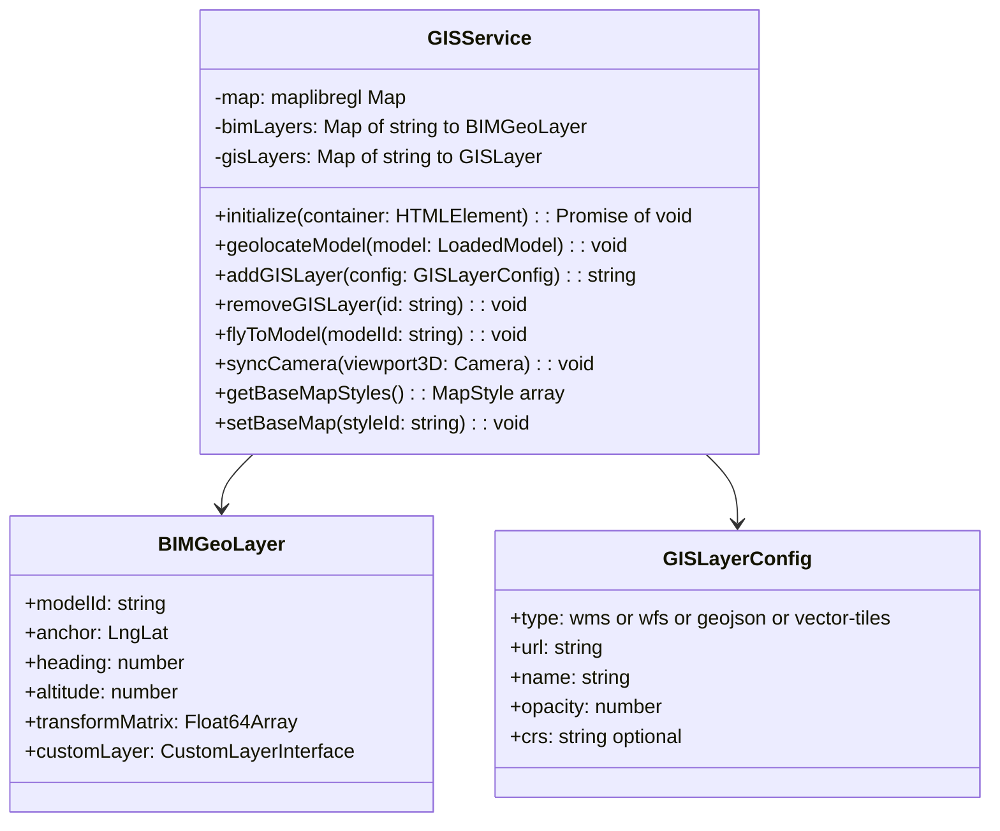

#### Flujo de Geolocalización Automática

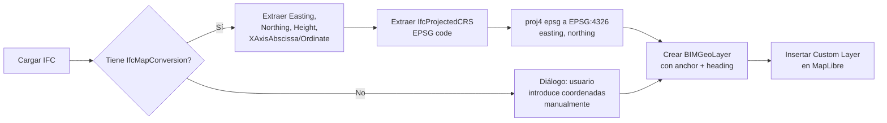

#### Capas GIS Soportadas

| Tipo | Fuente ejemplo para Galicia | Protocolo |
|---|---|---|
| **Base cartográfica** | OpenStreetMap / IGN PNOA | Raster tiles (XYZ) |
| **Ortofoto** | PNOA Máxima Actualidad | WMS / WMTS |
| **Catastro** | Sede Electrónica del Catastro | WMS |
| **Planeamiento** | IDE Galicia — SIOTUGA | WMS / WFS |
| **Parcelas** | Catastro INSPIRE | GeoJSON / WFS |
| **Capas de usuario** | Fichero local | GeoJSON / KML drag and drop |

### 5.3 Drawing Service — Generación de Dibujos 2D

**Responsabilidad**: Generar plantas, secciones y alzados 2D a partir de modelos 3D.

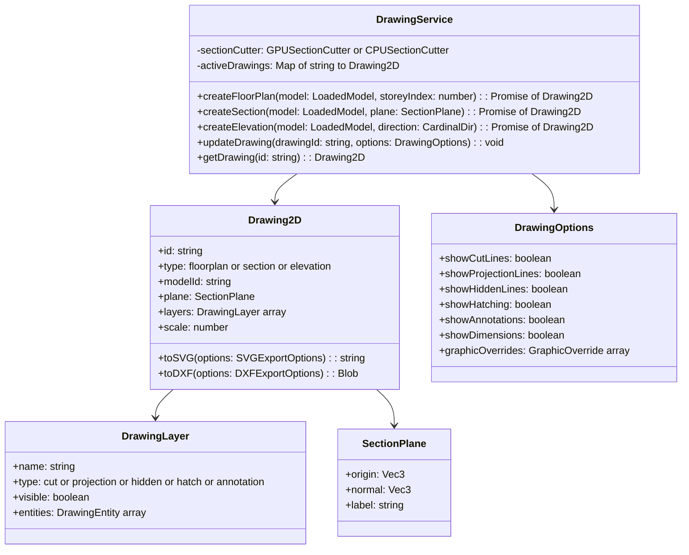

#### Pipeline de Generación 2D

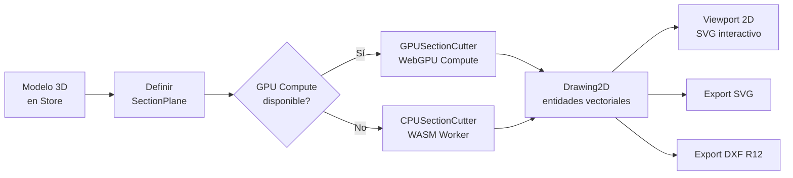

### 5.4 Export Service — Exportación a DXF

**Responsabilidad**: Serializar dibujos 2D y geometrías seleccionadas a formato DXF.

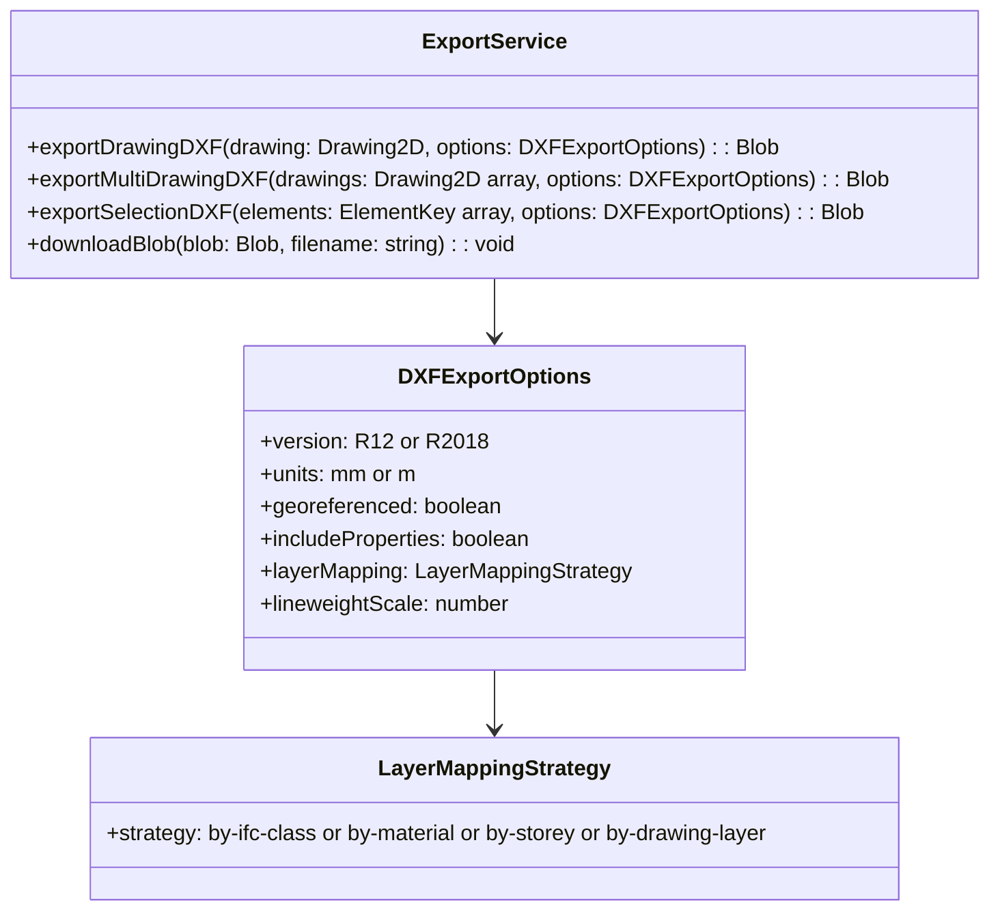

#### Estrategias de Mapeo de Capas DXF

| Estrategia | Resultado en AutoCAD |
|---|---|
| `by-ifc-class` | Capas: IfcWall, IfcSlab, IfcColumn, IfcDoor... |
| `by-material` | Capas: Hormigon_HA-30, Acero_S275, Ladrillo... |
| `by-storey` | Capas: Planta_00, Planta_01, Cubierta... |
| `by-drawing-layer` | Capas: CUT, PROJECTION, HIDDEN, HATCH, ANNOTATION |

### 5.5 Query Service — Consulta de Propiedades

**Responsabilidad**: Consultar propiedades, relaciones y metadatos de elementos IFC.

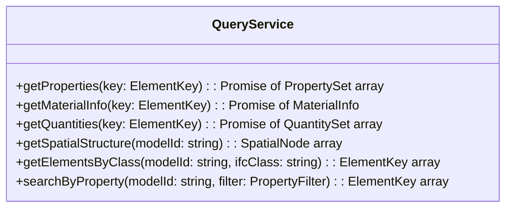

### 5.6 State Manager — Gestión de Estado

**Responsabilidad**: Store reactivo centralizado para todo el estado de la aplicación.

```typescript
// Interfaz del estado global
interface AppState {
  // Modelos
  models: Map<string, LoadedModelState>;
  activeModelId: string | null;

  // Selección
  selection: {
    hoveredElement: ElementKey | null;
    selectedElements: Set<ElementKey>;
    isolatedElements: Set<ElementKey> | null;
  };

  // Viewport 3D
  viewport3D: {
    cameraPosition: Vec3;
    cameraTarget: Vec3;
    clippingPlanes: ClippingPlane[];
    renderMode: 'shaded' | 'wireframe' | 'xray' | 'hidden-line';
  };

  // GIS
  gis: {
    enabled: boolean;
    basemapId: string;
    gisLayers: GISLayerState[];
    syncWithBIM: boolean;
  };

  // Dibujos 2D
  drawings: {
    activeDrawingId: string | null;
    drawingList: DrawingState[];
    drawingOptions: DrawingOptions;
  };

  // UI
  ui: {
    activePanel: PanelId | null;
    theme: 'light' | 'dark' | 'auto';
    language: 'gl' | 'es' | 'en';
    sidebarCollapsed: boolean;
    layout: LayoutMode;
  };
}
```

#### Patrón Observable Store

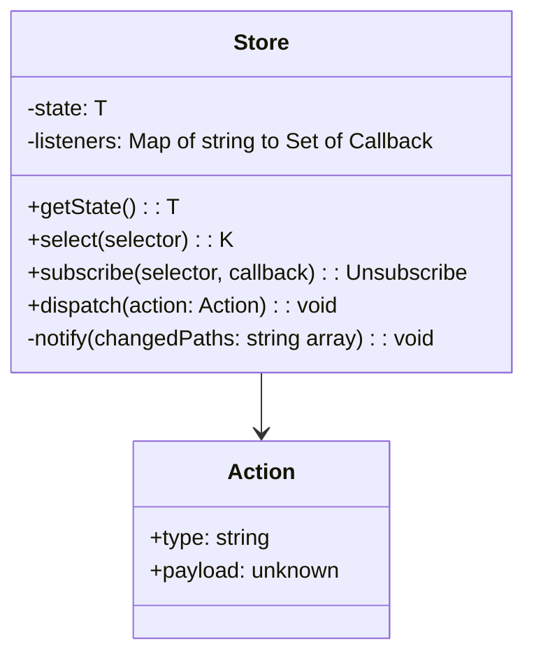

### 5.7 Command Bus — Orquestación

```typescript
// Ejemplo de comandos tipados
type Command =
  | { type: 'model/load'; payload: { file: File } }
  | { type: 'model/unload'; payload: { modelId: string } }
  | { type: 'model/setVisibility'; payload: { modelId: string; visible: boolean } }
  | { type: 'selection/select'; payload: { key: ElementKey } }
  | { type: 'selection/isolate'; payload: { keys: ElementKey[] } }
  | { type: 'gis/addLayer'; payload: GISLayerConfig }
  | { type: 'gis/geolocate'; payload: { modelId: string } }
  | { type: 'drawing/createFloorPlan'; payload: { modelId: string; storeyIndex: number } }
  | { type: 'drawing/createSection'; payload: { plane: SectionPlane } }
  | { type: 'export/dxf'; payload: { drawingId: string; options: DXFExportOptions } }
  | { type: 'viewport/setRenderMode'; payload: { mode: RenderMode } }
  | { type: 'viewport/addClippingPlane'; payload: { plane: ClippingPlane } };
```

### 5.8 UI Shell — Componentes de Presentación

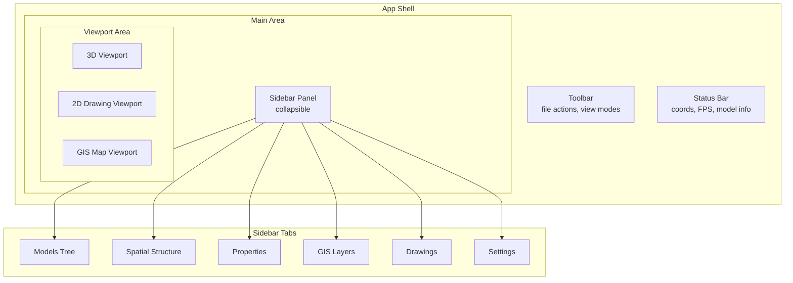

#### Layouts de Viewport

| Layout | Descripción | Uso |
|---|---|---|
| **Single 3D** | Solo viewport 3D a pantalla completa | Navegación general |
| **3D + Properties** | 3D con panel lateral de propiedades | Inspección de elementos |
| **3D + 2D Split** | Horizontal split: 3D arriba, 2D abajo | Trabajo con secciones |
| **3D + GIS Split** | Vertical split: 3D izquierda, mapa derecha | Contexto geográfico |
| **Triple** | 3D + 2D + GIS en tres paneles | Flujo completo |

---

## 6. Modelo de Datos

### 6.1 Diagrama Entidad-Relación del Estado

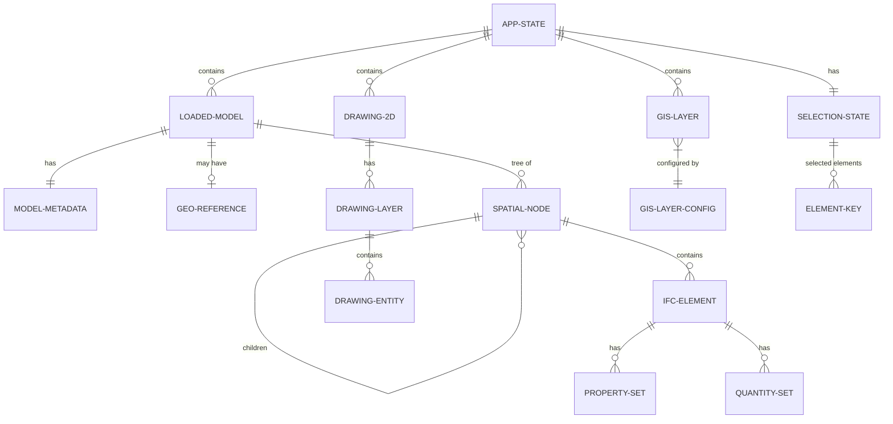

### 6.2 Formato de Persistencia Local

Para guardar sesiones de trabajo sin backend, se usa IndexedDB (vía idb-keyval) con la siguiente estructura:

| Store | Clave | Valor | TTL |
|---|---|---|---|
| `sessions` | `session-{uuid}` | models, gisLayers, drawings, viewState | 30 días |
| `model-cache` | `sha256(file)` | arrayBuffer, metadata | 7 días |
| `preferences` | `user-prefs` | theme, language, defaultLayers | Permanente |

---

## 7. Flujos de Interacción

### 7.1 Carga de Múltiples Ficheros IFC

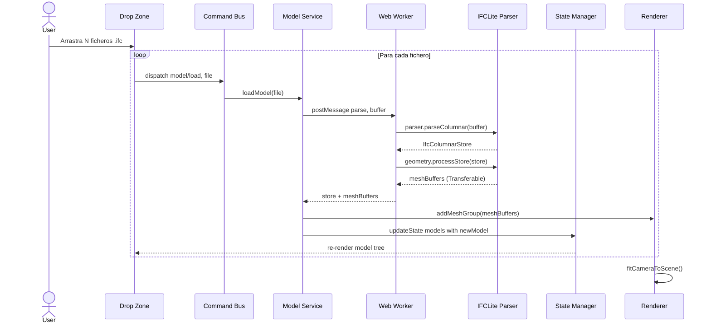

### 7.2 Generación y Exportación de Sección DXF

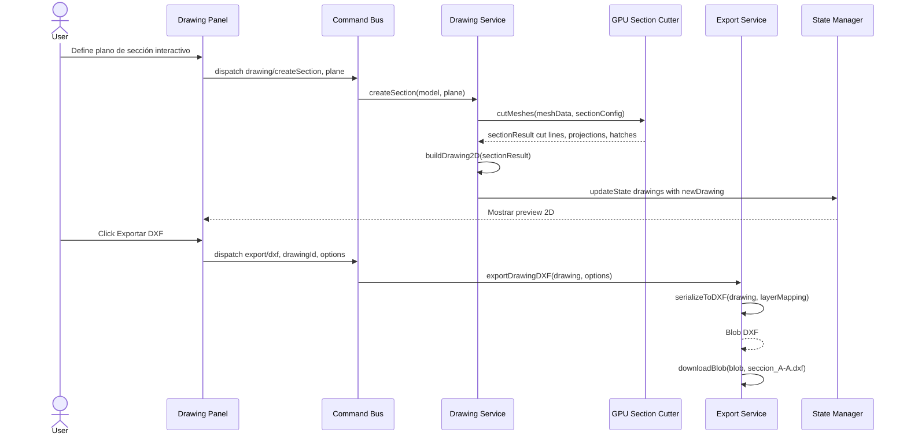

### 7.3 Geolocalización de Modelo en Mapa

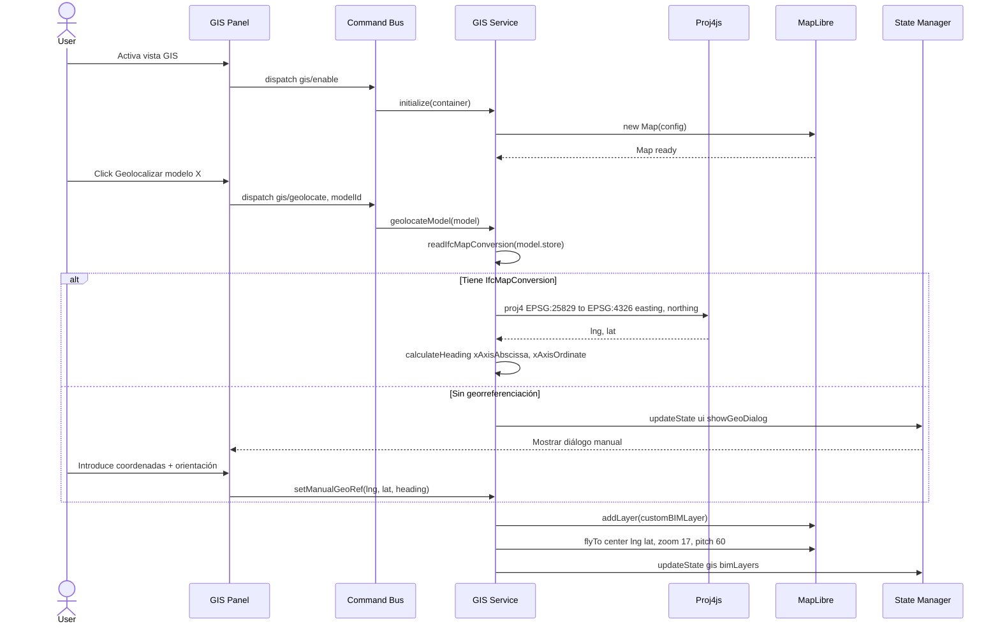

---

## 8. Requisitos No Funcionales

### 8.1 Rendimiento

| Métrica | Objetivo | Estrategia |
|---|---|---|
| **Tiempo de parsing** | Menor a 3s para IFC de 50 MB | WASM en Worker + streaming |
| **FPS de renderizado** | 30 FPS o más con 500K triángulos | WebGPU instancing + frustum culling |
| **Tiempo de carga inicial** | Menor a 2s (core bundle) | Code splitting + lazy loading |
| **Generación de sección** | Menor a 5s para modelo de 50 MB | GPU Compute shader cuando disponible |
| **Memoria máxima** | Menor a 2 GB para 3 modelos de 100 MB | Columnar store + dispose explícito |

### 8.2 Compatibilidad de Navegadores

| Navegador | Versión mín. | WebGPU | WebGL Fallback |
|---|---|---|---|
| Chrome / Edge | 113+ | Sí | Sí |
| Firefox | 130+ | Sí | Sí |
| Safari | 18+ | Sí | Sí |
| Safari iOS | 18+ | Sí | Sí |

### 8.3 Accesibilidad

| Criterio | Implementación |
|---|---|
| WCAG 2.1 AA (parcial) | Contraste de colores, navegación por teclado en paneles |
| i18n | Gallego (gl), Castellano (es), Inglés (en) |
| Responsive | Layouts adaptativos para tablet (768px+) y desktop (1024px+) |

### 8.4 Seguridad

| Aspecto | Medida |
|---|---|
| **Sin backend** | Eliminación del vector de ataque servidor |
| **Procesamiento local** | Los ficheros IFC nunca abandonan el navegador del usuario |
| **CSP** | Content Security Policy estricta en las headers de GitHub Pages |
| **Dependencias** | Auditoría con npm audit en CI; Dependabot activado |

### 8.5 Mantenibilidad

| Métrica | Objetivo |
|---|---|
| **Cobertura de tests unitarios** | 80% o más en servicios de dominio |
| **Tests E2E** | Flujos críticos (carga, sección, export) con Playwright |
| **Documentación** | TSDoc en todas las interfaces públicas |
| **Bundle budget** | Core menor a 500 KB gzipped (sin WASM) |

---

## 9. Estructura del Proyecto

```
VisorGuBIMGal/
├── .github/
│   └── workflows/
│       └── deploy.yml              # CI/CD a GitHub Pages
├── public/
│   ├── favicon.svg
│   ├── locales/
│   │   ├── gl.json                 # Gallego
│   │   ├── es.json                 # Castellano
│   │   └── en.json                 # Inglés
│   └── sample-models/              # Modelos IFC de demo (opcionales)
├── src/
│   ├── main.ts                     # Entry point
│   ├── app-shell.ts                # Root Web Component
│   │
│   ├── domain/                     # Capa de Dominio
│   │   ├── interfaces/             # Contratos / Ports
│   │   │   ├── IModelService.ts
│   │   │   ├── IGISService.ts
│   │   │   ├── IDrawingService.ts
│   │   │   ├── IExportService.ts
│   │   │   └── IQueryService.ts
│   │   ├── models/                 # Tipos y entidades de dominio
│   │   │   ├── LoadedModel.ts
│   │   │   ├── ElementKey.ts
│   │   │   ├── SectionPlane.ts
│   │   │   ├── Drawing2D.ts
│   │   │   └── GISLayer.ts
│   │   └── services/               # Implementaciones de dominio
│   │       ├── ModelService.ts
│   │       ├── GISService.ts
│   │       ├── DrawingService.ts
│   │       ├── ExportService.ts
│   │       └── QueryService.ts
│   │
│   ├── application/                # Capa de Aplicación
│   │   ├── commands/               # Tipos de comandos
│   │   │   └── commands.ts
│   │   ├── CommandBus.ts           # Dispatcher central
│   │   ├── Store.ts                # Observable State Manager
│   │   ├── AppState.ts             # Interfaz del estado
│   │   └── PluginManager.ts        # Sistema de plugins
│   │
│   ├── infrastructure/             # Capa de Infraestructura
│   │   ├── ifc/                    # Adaptadores IFCLite
│   │   │   ├── IfcParserAdapter.ts
│   │   │   ├── IfcGeometryAdapter.ts
│   │   │   ├── IfcRendererAdapter.ts
│   │   │   ├── IfcQueryAdapter.ts
│   │   │   └── IfcDrawingAdapter.ts
│   │   ├── gis/                    # Adaptadores MapLibre
│   │   │   ├── MapLibreAdapter.ts
│   │   │   ├── BIMCustomLayer.ts   # CustomLayerInterface
│   │   │   └── Proj4Adapter.ts
│   │   ├── export/                 # Adaptadores de exportación
│   │   │   ├── DXFWriterAdapter.ts
│   │   │   └── SVGExporter.ts
│   │   ├── workers/                # Web Workers
│   │   │   ├── ifc-parser.worker.ts
│   │   │   └── section-cutter.worker.ts
│   │   └── persistence/            # IndexedDB
│   │       └── SessionStore.ts
│   │
│   ├── presentation/               # Capa de Presentación
│   │   ├── components/             # Web Components (Lit)
│   │   │   ├── toolbar/
│   │   │   │   └── app-toolbar.ts
│   │   │   ├── sidebar/
│   │   │   │   ├── model-tree.ts
│   │   │   │   ├── spatial-tree.ts
│   │   │   │   ├── property-panel.ts
│   │   │   │   ├── gis-layers-panel.ts
│   │   │   │   └── drawing-panel.ts
│   │   │   ├── viewport/
│   │   │   │   ├── viewport-3d.ts
│   │   │   │   ├── viewport-2d.ts
│   │   │   │   └── viewport-gis.ts
│   │   │   ├── dialogs/
│   │   │   │   ├── georef-dialog.ts
│   │   │   │   ├── export-dialog.ts
│   │   │   │   └── settings-dialog.ts
│   │   │   └── shared/
│   │   │       ├── icon-button.ts
│   │   │       ├── split-pane.ts
│   │   │       ├── tab-panel.ts
│   │   │       └── drop-zone.ts
│   │   └── styles/                 # CSS con Design Tokens
│   │       ├── tokens.css          # Custom Properties
│   │       ├── reset.css           # CSS Reset
│   │       ├── layout.css          # Grid/Flex layouts
│   │       └── components.css      # Estilos compartidos
│   │
│   └── shared/                     # Utilidades transversales
│       ├── types.ts                # Tipos compartidos
│       ├── events.ts               # Custom Events tipados
│       ├── constants.ts
│       └── utils/
│           ├── file-utils.ts
│           ├── math-utils.ts
│           └── download-utils.ts
│
├── tests/
│   ├── unit/                       # Vitest
│   │   ├── domain/
│   │   └── application/
│   └── e2e/                        # Playwright
│       ├── load-model.spec.ts
│       ├── section-export.spec.ts
│       └── gis-geolocation.spec.ts
│
├── index.html
├── vite.config.ts
├── tsconfig.json
├── package.json
└── README.md
```

---

## 10. Pipeline de Despliegue

### 10.1 GitHub Actions Workflow

```yaml
# .github/workflows/deploy.yml
name: Deploy VisorGuBIMGal to GitHub Pages

on:
  push:
    branches: [main]
  workflow_dispatch:

permissions:
  contents: read
  pages: write
  id-token: write

concurrency:
  group: 'pages'
  cancel-in-progress: true

jobs:
  build:
    runs-on: ubuntu-latest
    steps:
      - uses: actions/checkout@v4
      - uses: actions/setup-node@v4
        with:
          node-version: 22
          cache: 'npm'
      - run: npm ci
      - run: npm run lint
      - run: npm run test:unit
      - run: npm run build
      - uses: actions/configure-pages@v5
      - uses: actions/upload-pages-artifact@v3
        with:
          path: './dist'

  deploy:
    environment:
      name: github-pages
      url: ${{ steps.deployment.outputs.page_url }}
    runs-on: ubuntu-latest
    needs: build
    steps:
      - id: deployment
        uses: actions/deploy-pages@v4
```

### 10.2 Configuración Vite

```typescript
// vite.config.ts
import { defineConfig } from 'vite';

export default defineConfig({
  base: '/VisorGuBIMGal/',
  build: {
    target: 'esnext',       // Necesario para WebGPU + top-level await
    outDir: 'dist',
    rollupOptions: {
      output: {
        manualChunks: {
          'ifc-core': ['@ifc-lite/parser', '@ifc-lite/geometry', '@ifc-lite/data'],
          'ifc-render': ['@ifc-lite/renderer'],
          'ifc-draw': ['@ifc-lite/drawing-2d'],
          'gis': ['maplibre-gl', 'proj4'],
        },
      },
    },
  },
  worker: {
    format: 'es',           // Workers como ES Modules
  },
  optimizeDeps: {
    exclude: ['@ifc-lite/parser'],  // WASM packages no deben pre-bundlearse
  },
});
```

---

## 11. Alternativas Descartadas

### 11.1 Motor BIM

| Alternativa | Razón de descarte |
|---|---|
| **web-ifc + web-ifc-three (That Open Company)** | Licencia AGPL-3.0 problemática para instituciones; sin drawing-2D ni DXF nativo; mayor consumo de memoria (object trees vs columnar) |
| **xBIM WebUI** | Requiere conversión server-side a wexbim; incompatible con frontend-only |
| **IFC.js v1** | Proyecto archivado; API legacy sin mantenimiento activo |
| **BIMServer + viewer** | Requiere backend Java; no desplegable en GitHub Pages |

### 11.2 Motor GIS

| Alternativa | Razón de descarte |
|---|---|
| **CesiumJS** | Bundle de ~3 MB; sobredimensionado para contexto regional (no necesitamos globo 3D); complejidad de integración con renderer BIM propio |
| **OpenLayers** | Sin rendering 3D nativo; no soporta Custom Layers con WebGL compartido |
| **Leaflet** | Solo 2D; sin pitch/bearing para visualización oblicua; requiere plugins pesados para 3D |
| **deck.gl** | Especializado en visualización de datos, no BIM; dependencia pesada |

### 11.3 Exportación DXF

| Alternativa | Razón de descarte |
|---|---|
| **Maker.js** | Motor paramétrico innecesario; no aporta valor sobre el export nativo de IFCLite |
| **JSCAD** | Orientado a CAD paramétrico 3D, no a exportación de dibujos arquitectónicos 2D |
| **svg-to-dxf (custom)** | Conversión SVG a DXF pierde información de capas y semántica; IFCLite ya exporta DXF directo |

### 11.4 Framework UI

| Alternativa | Razón de descarte |
|---|---|
| **React** | Bundle innecesario (~40 KB gz); Virtual DOM no aporta en UI con pocos re-renders; la lógica pesada está en WASM/WebGPU |
| **Vue** | Similar a React en overhead innecesario |
| **Angular** | Sobredimensionado para este tipo de aplicación |
| **Solid.js** | Viable, pero LitElement ofrece Web Components estándar (mejor interop con custom elements del renderer) |

---

## 12. Glosario

| Término | Definición |
|---|---|
| **AEC** | Architecture, Engineering and Construction |
| **BCF** | BIM Collaboration Format — estándar para comunicar incidencias sobre modelos BIM |
| **BIM** | Building Information Modeling |
| **CRS** | Coordinate Reference System — sistema de referencia de coordenadas |
| **DXF** | Drawing Exchange Format — formato de intercambio de dibujos CAD (Autodesk) |
| **EPSG** | European Petroleum Survey Group — catálogo de sistemas de referencia (p.ej. EPSG:25829) |
| **ETRS89** | European Terrestrial Reference System 1989 — datum geodésico oficial de España |
| **Express ID** | Identificador numérico único de cada entidad dentro de un fichero IFC |
| **IDS** | Information Delivery Specification — estándar para validar requisitos de información BIM |
| **IFC** | Industry Foundation Classes — estándar ISO 16739 para intercambio de datos BIM |
| **IFC STEP** | Formato de texto plano de ficheros IFC basado en ISO 10303 STEP |
| **IFCX** | Nombre provisional del formato IFC5 basado en JSON |
| **LitElement** | Clase base de Google para crear Web Components reactivos |
| **Modelo federado** | Conjunto de modelos BIM de distintas disciplinas cargados en un visor único |
| **MPL-2.0** | Mozilla Public License 2.0 — licencia copyleft débil |
| **SDD** | Software Design Document |
| **SPA** | Single Page Application |
| **WASM** | WebAssembly — formato binario de ejecución en navegadores |
| **WebGPU** | API moderna de acceso a GPU para rendering y compute |
| **WFS** | Web Feature Service — protocolo OGC para servir features geoespaciales |
| **WMS** | Web Map Service — protocolo OGC para servir mapas como imágenes |

---

## 13. Roadmap de Fases

### Fase 1 — MVP Core (8 semanas)

**Objetivo**: Visor 3D funcional con carga de múltiples IFC

| Tarea | Paquetes | Prioridad |
|---|---|---|
| Setup del proyecto (Vite + TS + Lit) | — | P0 |
| App Shell (layout, toolbar, sidebar) | — | P0 |
| ModelService + Web Worker parsing | @ifc-lite/parser, @ifc-lite/geometry, @ifc-lite/data | P0 |
| Viewport 3D con renderer WebGPU | @ifc-lite/renderer | P0 |
| Carga multi-modelo (drag and drop) | — | P0 |
| Árbol de modelos + toggle visibilidad | — | P0 |
| Navegación espacial (storey tree) | @ifc-lite/query | P0 |
| Selección + panel de propiedades | @ifc-lite/query | P1 |
| Planos de corte interactivos | — | P1 |
| Modos de render (shaded, wireframe, xray) | — | P1 |
| i18n (gl, es, en) | — | P1 |
| CI/CD GitHub Actions | — | P0 |

### Fase 2 — Dibujos 2D y Exportación DXF (4 semanas)

**Objetivo**: Generación de plantas/secciones exportables

| Tarea | Paquetes | Prioridad |
|---|---|---|
| DrawingService con GPUSectionCutter | @ifc-lite/drawing-2d | P0 |
| Viewport 2D (SVG interactivo) | — | P0 |
| Generación de plantas por planta | — | P0 |
| Generación de secciones verticales | — | P0 |
| Capas de dibujo (cut, projection, hidden, hatch) | — | P1 |
| ExportService — DXF R12 | @ifc-lite/drawing-2d, dxf-writer | P0 |
| Estrategias de mapeo de capas DXF | — | P1 |
| Export SVG | — | P1 |
| Diálogo de exportación con opciones | — | P1 |

### Fase 3 — Integración GIS (4 semanas)

**Objetivo**: Contexto geográfico completo

| Tarea | Paquetes | Prioridad |
|---|---|---|
| GISService + MapLibre initialization | maplibre-gl | P0 |
| Custom Layer bridge (BIM a MapLibre) | — | P0 |
| Geolocalización automática (IfcMapConversion) | proj4 | P0 |
| Geolocalización manual (diálogo) | — | P0 |
| Carga de capas WMS/WMTS (IGN, Catastro, IDE Galicia) | — | P1 |
| Carga de GeoJSON / KML local | — | P1 |
| Panel de gestión de capas GIS | — | P1 |
| Selector de mapa base | — | P1 |
| Layout split 3D + GIS | — | P0 |
| Sincronización de cámara BIM a mapa | — | P2 |

### Fase 4 — Pulido y Funcionalidades Avanzadas (4 semanas)

**Objetivo**: UX profesional y features extendidos

| Tarea | Paquetes | Prioridad |
|---|---|---|
| Tema oscuro / claro / auto | — | P1 |
| Persistencia de sesión (IndexedDB) | idb-keyval | P1 |
| Mediciones 3D (distancia, área, ángulo) | — | P2 |
| Anotaciones en drawings 2D | — | P2 |
| Búsqueda de elementos por propiedad | — | P1 |
| Colorización por propiedad (visual overrides) | — | P2 |
| Soporte BCF (viewpoints, topics) | @ifc-lite/bcf | P2 |
| Tests E2E con Playwright | — | P1 |
| Documentación de usuario (guía interactiva) | — | P1 |
| Optimización de rendimiento (profiling) | — | P1 |

---

> **NOTA**: Este documento es un **living document**. Debe actualizarse conforme evolucione la implementación. Los cambios sustanciales deben pasar por Pull Request con revisión.
